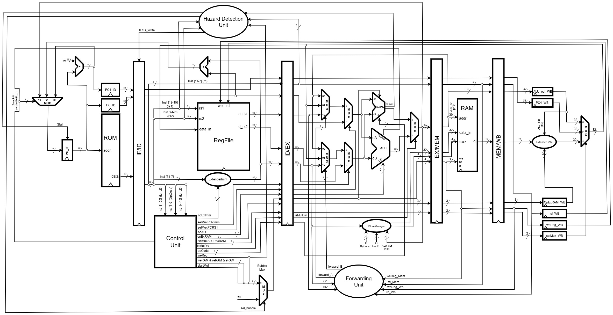

# 5-Stage Pipelined RV32 Processor Architecture

This document describes the microarchitectural organization of the processor, the structural decomposition into five stages, the handling of data and control hazards, and the integration of the `M`, `Zicsr`, and `Zifencei` extensions.



## 1. Overview and Structural Decomposition

The processor executes the 32-bit RISC-V instruction set in an in-order 5-stage pipeline synchronized on the rising edge of a single clock (`i_clk`). The structural top level connects exclusively the five stage entities and the four inter-stage barrier registers:

```
┌──────────┐  reg_if_id  ┌──────────┐  reg_id_ex  ┌──────────┐  reg_ex_mem  ┌───────────┐  reg_mem_wb  ┌──────────┐
│ stage_if │ ──────────► │ stage_id │ ──────────► │ stage_ex │ ───────────► │ stage_mem │ ───────────► │ stage_wb │
└──────────┘             └──────────┘             └──────────┘              └───────────┘              └──────────┘
     ▲                        │                       ▲  ▲                                                  │
     │                        ▼                       │  │                                                  │
     │                  ┌──────────┐       ┌──────────────────────┐                                         │
     │                  │   HDU    │       │   Forwarding Unit    │                                         │
     │                  │ (stall)  │       │  EX/MEM and MEM/WB   │                                         │
     │                  └──────────┘       └──────────────────────┘                                         │
     └───────────────────────────────────────── wb_data / PC redirection ◄──────────────────────────────────┘
```

| Layer | Architectural role |
| :--- | :--- |
| Stage 1 (IF) | Holds the Program Counter (PC), computes $\text{PC} + 4$, selects the next PC source, and decodes the instruction fetch region across Boot ROM, Flash, and external instruction cache (SDRAM) |
| IF/ID Barrier | Registers validity (`o_valid`), `o_pc`, `o_pc4`, and the instruction `o_inst`, responding to freeze (`i_en = '0'`) and discard (`i_flush = '1'`) |
| Stage 2 (ID) | Decodes base RV32I and active extension (`M` and `Zicsr`) control signals, extends the 32-bit immediate, reads `rs1` and `rs2` from the register file with internal write-through bypass, and detects load-use hazards |
| ID/EX Barrier | Registers read operands, extended immediate, `rs1`, `rs2`, and `rd` indices, and all control signals for execution, memory, and write-back |
| Stage 3 (EX) | Applies operand forwarding, executes ALU operations, coordinates the multi-cycle multiplier/divider (`M`), evaluates branches and jumps (`BRANCH`, `JAL`, `JALR`), formats memory stores, and processes CSRs, exceptions, and `FENCE.I` |
| EX/MEM Barrier | Registers the final execution result, store data and byte mask, destination `rd`, and memory/write-back control signals |
| Stage 4 (MEM) | Decodes the effective address across data Flash, internal RAM, and the external SDRAM/peripheral bus, asserting `o_sdram_wait` while the external slave has not yet responded |
| MEM/WB Barrier | Registers `o_pc4`, the execution result `o_alu_out`, destination `o_rd`, and the read-extension and write-back selectors |
| Stage 5 (WB) | Selects the raw word returned by the accessed memory, applies byte/halfword alignment and sign or zero extension, and chooses the final datum written to the register file |

## 2. Hazard Handling

### 2.1. Data Forwarding (RAW Forwarding)

The forwarding unit in the EX stage compares the source registers of the executing instruction (`i_ex_rs1` and `i_ex_rs2`) against the destination registers of the instructions in the MEM (`i_exmem_rd`) and WB (`i_memwb_rd`) stages. Forwarding occurs only when the older instruction is valid, enables register writeback, and targets a register other than `x0` (`REG_ZERO`).

When both MEM and WB write to the same source register, the MEM stage takes priority because it holds the most recent value in program order:

| Code (`o_fwd_rs1` / `o_fwd_rs2`) | Source selected in the EX 4x1 mux | Activation condition |
| :--- | :--- | :--- |
| `"00"` | Value read from the register file in the ID stage (`i_rs1_val` / `i_rs2_val`) | No active dependency with MEM or WB |
| `"10"` | Result computed in the EX stage and registered in EX/MEM (`i_exmem_alu_out`) | `i_exmem_we_reg = '1'` and `i_exmem_valid = '1'` and `i_exmem_rd = i_ex_rs* /= x0` |
| `"01"` | Final write-back datum in the WB stage (`i_wb_data`) | `i_memwb_we_reg = '1'` and `i_memwb_valid = '1'` and `i_memwb_rd = i_ex_rs* /= x0` (without a match in EX/MEM) |

For dependencies three cycles apart (an instruction in ID reading the same register being written by WB in the same cycle), the register file provides internal write-through bypass via 2x1 multiplexers on the `o_rs1` and `o_rs2` read ports.

### 2.2. Load-Use Hazard Stall

Because synchronous data memory delivers read data only at the WB stage, an instruction in ID that immediately depends on a load in the EX stage (`i_idex_re_ram = '1'` and `i_idex_rd /= x0`) must wait one cycle:

1. The hazard detection unit checks the `opcode` of the instruction in ID to determine whether it actually reads `rs1` (`OP`, `OP_IMM`, `LOAD`, `STORE`, `BRANCH`, `JALR`, `SYSTEM`) and whether it actually reads `rs2` (`OP`, `STORE`, `BRANCH`), avoiding false stalls when the `rs2` bit field is part of an immediate.
2. When the hazard is confirmed, the HDU deasserts `o_pc_we` and `o_ifid_we` (freezing the PC and the IF/ID register) and asserts `o_bubble_sel = '1'`.
3. The bubble multiplexer (`bubble_mux`) zeroes the four side-effect control signals (`o_we_reg`, `o_we_ram`, `o_re_ram`, and `o_en_ram`) and the ID stage marks `o_idex_valid = '0'`, injecting a `NOP` into the ID/EX register.

### 2.3. Control Hazards and PC Redirection

Conditional branches, unconditional jumps, exceptions, and `FENCE.I` barriers are resolved in the EX stage under an *assume-not-taken* speculative policy. The next-PC selector in the IF stage follows this priority order:

| Priority | `pc_src` code | Next-PC source | Condition in the EX stage |
| :--- | :--- | :--- | :--- |
| 1 (highest) | `PC_SRC_REDIRECT` (`"11"`) | `i_redirect_pc` (`csr_mepc` on `MRET`, `i_pc4` on `FENCE.I`, or `csr_mtvec` on trap) | `i_trap_take = '1'` or `i_mret_take = '1'` or `i_fencei_take = '1'` |
| 2 | `PC_SRC_JALR` (`"10"`) | `i_jalr_target` = $((\text{rs1} + \text{imm}) \land \texttt{0xFFFFFFFE})$, computed by the ALU (`ALU_JALR`) | `i_ex_jalr_taken = '1'` (`i_valid = '1'` and `i_opcode = OPCODE_JALR`) |
| 3 | `PC_SRC_BRANCH` (`"01"`) | `i_branch_target` = $\text{PC} + \text{imm}$, computed by the dedicated branch adder | `i_ex_branch_taken = '1'` (`i_valid = '1'` with `OPCODE_JAL` or satisfied `OPCODE_BRANCH`) |
| 4 (default) | `PC_SRC_PC4` (`"00"`) | $\text{PC} + 4$ | Normal sequential flow |

When a branch or jump is taken while the pipeline is advancing (`pipe_run = '1'`), or when a trap, `MRET`, or `FENCE.I` occurs, `reg_if_id` and `reg_id_ex` receive `i_flush = '1'`, discarding the two speculatively fetched instructions.

### 2.4. Global Multi-Cycle Stall Coordination

Three conditions in the EX and MEM stages can pause pipeline progression:

$$
\begin{aligned}
\text{base\_run} &= \neg (\text{muldiv\_stall} \lor \text{sdram\_wait}) \\
\text{pipe\_run} &= \text{base\_run} \land \neg \text{fencei\_busy} \\
\text{pipe\_stall} &= \text{muldiv\_stall} \lor \text{sdram\_wait} \lor \text{fencei\_busy}
\end{aligned}
$$

- While `muldiv_stall = '1'` or `sdram_wait = '1'`, `base_run` is `'0'`, freezing `reg_id_ex`, `reg_ex_mem`, and `reg_mem_wb`, as well as the PC and `reg_if_id` via `pipe_stall` in the HDU.
- While `fencei_busy = '1'` (waiting for a write-back data-cache flush to finish) with `base_run = '1'`, the front of the pipeline (`PC`, `IF/ID`, and `ID/EX`) remains held (`pipe_run = '0'`), `reg_ex_mem` receives `i_flush = '1'` (injecting bubbles), and `reg_mem_wb` keeps advancing to drain pending data-memory accesses.

## 3. ISA Extensions

### 3.1. M Extension (Integer Multiplication and Division)

When `has_m = true`, the `m_decode` decoder in the ID stage recognizes R-type instructions with `opcode = OPCODE_OP` (`"0110011"`) and `funct7 = FUNCT7_MULDIV` (`"0000001"`), asserting `o_is_muldiv = '1'`, `o_we_reg = '1'`, and `o_sel_pc_rs1 = '1'`.

In the EX stage, the `multdiv` unit internally generates a single start pulse (`start_pulse`) on the first cycle in which a valid instruction enters EX, latches `i_funct3` in a dedicated register throughout the operation, and triggers the corresponding operator:

| Internal operator | Instructions served | Latency | Corner-case handling |
| :--- | :--- | :--- | :--- |
| Radix-2 Booth multiplier (`booth_multiplier_rv32`) | `MUL`, `MULH`, `MULHSU`, `MULHU` | 33 cycles (1 init + 32 steps) | The upper signed 32-bit product receives post-multiplication correction via 32-bit adders for unsigned operands (`MULHSU` and `MULHU`) |
| 34-bit non-restoring divider (`non_restoring_divider_rv32`) | `DIV`, `DIVU`, `REM`, `REMU` | 34 cycles (normal case) / 2 cycles (special cases) | Division by zero returns quotient `0xFFFFFFFF` and remainder equal to the dividend; signed overflow ($-2^{31} / -1$) returns quotient `0x80000000` and remainder `0` |

The `o_stall` signal stays active while the operator is busy (`busy = '1'`) and during the completion pulse cycle (`done = '1'`), ensuring that the internal output register captures the final result before releasing the pipeline.

### 3.2. Zicsr Extension and Trap Handling

When `has_zicsr = true`, the `csr_decode` decoder in the ID stage identifies the `OPCODE_SYSTEM` class (`"1110011"`), forces I-type immediate extraction (`instr[31:20]`) to carry the 12-bit CSR address into EX, and asserts `o_is_csr = '1'` and `o_we_reg = '1'` for the six CSR access instructions (`CSRRW`, `CSRRS`, `CSRRC`, `CSRRWI`, `CSRRSI`, `CSRRCI`).

In the EX stage:

1. The `csr_file` bank combinationally reads the current CSR value (`o_rdata`) and, on the rising clock edge when `i_commit = i_is_csr and i_valid and i_pipe_run`, atomically updates the register according to `i_op(1 downto 0)` (`"01"` = direct write, `"10"` = bit set, `"11"` = bit clear). In `CSRRS`/`CSRRC` operations with a zero source operand (`rs1 = x0` or `zimm = 0`), no write is performed.
2. The `trap_unit` checks for jump/branch target address misalignment (`mcause = 0`), illegal `SYSTEM` instruction or CSR access (`mcause = 2`), `EBREAK` (`mcause = 3`), misaligned load address (`mcause = 4`), misaligned store address (`mcause = 6`), and `ECALL` (`mcause = 11`), as well as `MRET` return.
3. On an exception (`o_trap_take = '1'`), `reg_ex_mem` is flushed to cancel the faulting instruction's side effects, `csr_file` saves the PC in `mepc`, the cause in `mcause`, and the trap value in `mtval`, copies `MIE` into `MPIE`, clears `MIE`, and redirects the PC to `mtvec`.

### 3.3. Zifencei Extension

When `has_zifencei = true`, the `fencei_unit` in the EX stage detects the `FENCE.I` instruction (`opcode = OPCODE_MISC_MEM` and `funct3 = FUNCT3_FENCE_I`). Without a write-back data cache (`has_dcache = false`), it pulses `o_take = '1'` immediately when `i_run = '1'`. With a data cache (`has_dcache = true`), it requests a flush (`o_flush_req = '1'`), holds `o_busy = '1'` until `i_dc_done = '1'` is received, and then pulses `o_take = '1'`, invalidating the external instruction cache (`o_ic_inval = '1'`), flushing `IF/ID` and `ID/EX`, and redirecting the PC to $\text{PC} + 4$.

---

Copyright 2026 Insper. Licensed under the [Apache License, Version 2.0](../../LICENSE).
