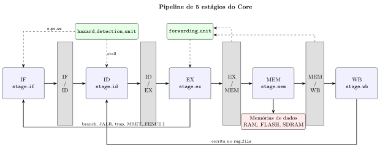
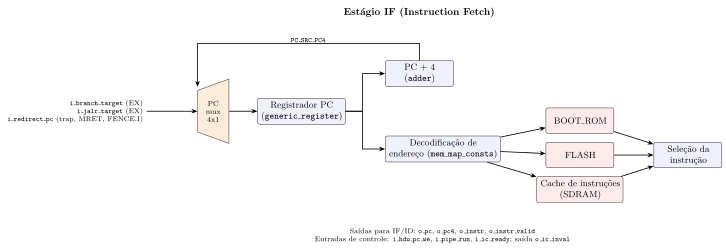
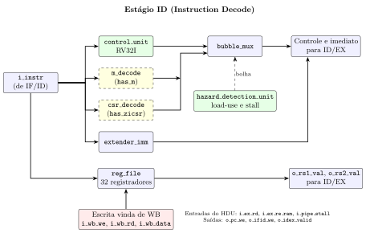
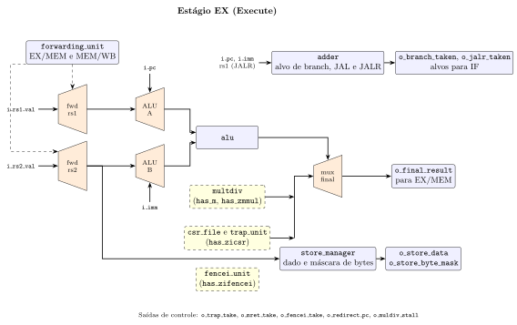
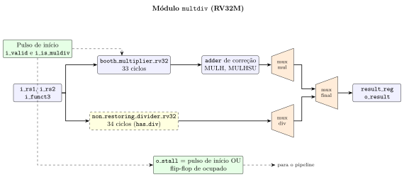
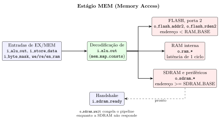
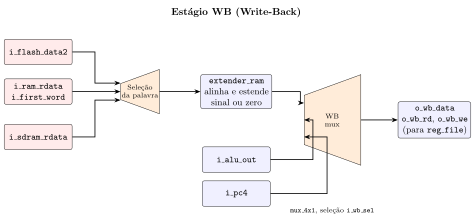

# RV32 Pipeline Stages and Signals Guide

This guide details the inputs, outputs, internal components, and control encodings of each of the five pipeline stages and four inter-stage barrier registers of the processor.

## 1. Structural Top Level and Pipeline Stages

The processor is divided into five stage entities located in `core/` and four barrier registers in `common/`, interconnected by the top level `src/core/core.vhd`:

| Order | Entity | File | Primary function |
| :--- | :--- | :--- | :--- |
| 1 | `stage_if` | `src/core/stage_if.vhd` | Next-PC source selection, $\text{PC} + 4$ increment, code-region decoding (Boot ROM, Flash, SDRAM I-cache), and fetch-wait control |
| Barrier 1 | `reg_if_id` | `src/shared/reg_if_id.vhd` | Synchronous registration of `o_valid`, `o_pc`, `o_pc4`, and `o_inst` between IF and ID |
| 2 | `stage_id` | `src/core/stage_id.vhd` | RV32I + `M`/`Zicsr` decoding, immediate extension, register-file read/write, load-use hazard detection, and bubble insertion |
| Barrier 2 | `reg_id_ex` | `src/shared/reg_id_ex.vhd` | Synchronous registration of operands, immediate, register indices, and control signals between ID and EX |
| 3 | `stage_ex` | `src/core/stage_ex.vhd` | Operand forwarding, ALU execution, MulDiv unit, CSR file and Trap Unit, `FENCE.I` unit, branch target calculation, and store alignment |
| Barrier 3 | `reg_ex_mem` | `src/shared/reg_ex_mem.vhd` | Synchronous registration of EX result, store data and byte mask, destination `rd`, and memory/WB controls between EX and MEM |
| 4 | `stage_mem` | `src/core/stage_mem.vhd` | Data-space decoding (Flash port 2, internal RAM, and external SDRAM/peripheral window) and wait control `o_sdram_wait` |
| Barrier 4 | `reg_mem_wb` | `src/shared/reg_mem_wb.vhd` | Synchronous registration of `o_alu_out`, `o_rd`, `o_we_reg`, `o_ext_ram_op`, and `o_wb_sel` between MEM and WB |
| 5 | `stage_wb` | `src/core/stage_wb.vhd` | Selection of the word read from memory, byte/halfword extension (`extender_ram`), and selection of the final value written to the register file |

## 2. Stage-by-Stage Breakdown

### 2.1. Stage 1: Instruction Fetch (`stage_if` and `pc_fetch`)

The IF stage selects the next instruction address through the `pc_src` code (`pc_src_t`) defined in `src/shared/pc_src_consts.vhd`:

| Constant | Code | Source selected in the `mux_4x1` of `pc_fetch` |
| :--- | :--- | :--- |
| `PC_SRC_PC4` | `"00"` | $\text{PC} + 4$ computed by the `u_pc4_adder` adder |
| `PC_SRC_BRANCH` | `"01"` | `i_branch_target` ($\text{PC} + \text{imm}$, for a taken `BRANCH` or `JAL`) |
| `PC_SRC_JALR` | `"10"` | `i_jalr_target` ($((\text{rs1} + \text{imm}) \land \texttt{0xFFFFFFFE})$, for `JALR`) |
| `PC_SRC_REDIRECT` | `"11"` | `i_redirect_pc` (`mepc` on `MRET`, $\text{PC} + 4$ on `FENCE.I`, or `mtvec` on exception) |

Instruction fetch address (`if_pc`) decoding uses the bounds from `src/shared/mem_map_consts.vhd`:

| Address range (`if_pc`) | Selected region | Word delivered on `o_instr` |
| :--- | :--- | :--- |
| `< 0x00000800` (`BOOT_ROM_SIZE_BYTES`) | Boot ROM | `i_boot_rom_data` |
| `0x00000800 .. 0x3FFFFFFF` | Flash memory (port 1) | `i_flash_data` |
| `>= 0x40000000` (`SDRAM_BASE_BYTES`) | External instruction cache (SDRAM, `o_ic_sel = '1'`) | `i_ic_data` (freezes the PC and clears `o_instr_valid` while `i_ic_ready = '0'`) |

### 2.2. Stage 2: Instruction Decode and Register Read (`stage_id`)

The ID stage comprises seven sub-blocks:

1. **Base control unit (`control_unit`):** decodes `i_inst` to produce `o_sel_pc4_alu`, `o_ext_imm_op`, `o_wb_sel`, `o_we_reg`, `o_ext_ram_op`, `o_sel_rs2_imm`, `o_sel_pc_rs1`, `o_alu_op`, `o_we_ram`, `o_re_ram`, `o_en_ram`, `o_opcode`, and `o_funct3`.
2. **RV32M decoder (`m_decode`, when `has_m = true`):** asserts `o_is_muldiv = '1'`, `o_we_reg = '1'`, and `o_sel_pc_rs1 = '1'` when `opcode = OPCODE_OP` and `funct7 = FUNCT7_MULDIV`.
3. **Zicsr decoder (`csr_decode`, when `has_zicsr = true`):** asserts `o_use_imm_i = '1'` for the entire `OPCODE_SYSTEM` class and asserts `o_is_csr = '1'` and `o_we_reg = '1'` when `funct3` is neither `"000"` nor `"100"`.
4. **Immediate extender (`extender_imm`):** reconstructs the 32-bit immediate according to `src/shared/ext_imm_consts.vhd`:

| Constant | Code | Format and extension operation |
| :--- | :--- | :--- |
| `EXT_IMM_U` | `"000"` | $\text{instr}[31{:}12] \ll 12$ (`LUI`, `AUIPC`) |
| `EXT_IMM_I` | `"001"` | $\text{sext}(\text{instr}[31{:}20])$ (arithmetic I-type, loads, `JALR`, CSR address) |
| `EXT_IMM_I_SHAMT` | `"010"` | $\text{zext}(\text{instr}[24{:}20])$ (`SLLI`, `SRLI`, `SRAI`) |
| `EXT_IMM_J` | `"011"` | $\text{sext}(\text{instr}[31] \,\&\, \text{instr}[19{:}12] \,\&\, \text{instr}[20] \,\&\, \text{instr}[30{:}21] \,\&\, \texttt{'0'})$ (`JAL`) |
| `EXT_IMM_S` | `"100"` | $\text{sext}(\text{instr}[31{:}25] \,\&\, \text{instr}[11{:}7])$ (`SB`, `SH`, `SW`) |
| `EXT_IMM_B` | `"101"` | $\text{sext}(\text{instr}[31] \,\&\, \text{instr}[7] \,\&\, \text{instr}[30{:}25] \,\&\, \text{instr}[11{:}8] \,\&\, \texttt{'0'})$ (`BEQ`..`BGEU`) |

5. **Register file (`reg_file`):** 32 32-bit registers (`x0` hardwired to zero and `x1`..`x31` instantiated with `generic_register`), write decoding via `onehot_decoder`, dual combinational read via `mux_tree`, and write-through bypass via `mux_2x1` when `i_enable = '1'` and the read address matches `i_rd /= x0`.
6. **Hazard detection (`hazard_detection_unit`) and bubble insertion (`bubble_mux`):** freezes PC and IF/ID (`o_pc_we = '0'`, `o_ifid_we = '0'`) and zeroes `o_we_reg`, `o_we_ram`, `o_re_ram`, and `o_en_ram` (`o_bubble_sel = '1'`) during load-use hazards or multi-cycle stalls (`i_pipe_stall = '1'`).
7. **Forwarding comparison (`forwarding_match`):** compares `rs1` and `rs2` of the instruction in ID with the destination `rd` of the three instructions ahead of it (ID/EX, EX/MEM, and MEM/WB), which will be in EX/MEM, MEM/WB, and WB2 in the next cycle. A destination of `x0`, or one without register write enabled, never matches. The three match bits of each operand are registered in ID/EX (`fwd_match_t`, positions `FWD_MATCH_EXMEM`, `FWD_MATCH_MEMWB`, and `FWD_MATCH_WB2` of `src/shared/fwd_consts.vhd`).

### 2.3. Stage 3: Execute (`stage_ex`)

In the EX stage:

1. **Forwarding (`forwarding_unit`):** selects each operand (`ex_fwd_rs1_val` and `ex_fwd_rs2_val`) via `mux_4x1` from the ID/EX value (`"00"`), the EX result registered in MEM/WB (`"01"`), the EX/MEM result (`"10"`), or the final WB datum registered in WB2 (`"11"`). The choice does not compare register indices, because it depends only on the match bits registered in ID/EX and on the valid-and-writes bits registered in EX/MEM, MEM/WB, and WB2, and the newest source that matches and is still valid wins.
2. **ALU input selection:** two `mux_2x1` multiplexers select operand A (`i_pc` when `i_sel_pc_rs1 = '0'`, or `ex_fwd_rs1_val` when `'1'`) and operand B (`ex_fwd_rs2_val` when `i_sel_rs2_imm = '0'`, or `i_imm` when `'1'`).
3. **ALU (`alu`):** executes the operation defined in `src/shared/alu_consts.vhd`:

| Constant | Code | Operation on `o_d` | `o_branch` flag |
| :--- | :--- | :--- | :--- |
| `ALU_ADD` | `"00000"` | `unsigned(i_a) + unsigned(i_b)` | `'0'` |
| `ALU_SLL` | `"00001"` | `i_a << unsigned(i_b[4:0])` | `'0'` |
| `ALU_XOR` | `"00100"` | `i_a xor i_b` | `'0'` |
| `ALU_SRL` | `"00101"` | `unsigned(i_a) >> unsigned(i_b[4:0])` | `'0'` |
| `ALU_OR` | `"00110"` | `i_a or i_b` | `'0'` |
| `ALU_AND` | `"00111"` | `i_a and i_b` | `'0'` |
| `ALU_SUB` | `"01000"` | `unsigned(i_a) - unsigned(i_b)` | `'0'` |
| `ALU_SLT` | `"01010"` | `1` if `signed(i_a) < signed(i_b)`, else `0` | `'0'` |
| `ALU_SLTU` | `"01011"` | `1` if `unsigned(i_a) < unsigned(i_b)`, else `0` | `'0'` |
| `ALU_SRA` | `"01101"` | `signed(i_a) >> unsigned(i_b[4:0])` | `'0'` |
| `ALU_JALR` | `"10000"` | `(unsigned(i_a) + unsigned(i_b)) & ~1` | `'0'` |
| `ALU_LUI` | `"10001"` | `i_b` (operand A forced to zero) | `'0'` |
| `ALU_BEQ` | `"11000"` | `0` | `'1'` if `i_a = i_b` |
| `ALU_BNE` | `"11001"` | `0` | `'1'` if `i_a /= i_b` |
| `ALU_BLT` | `"11100"` | `0` | `'1'` if `signed(i_a) < signed(i_b)` |
| `ALU_BGE` | `"11101"` | `0` | `'1'` if `signed(i_a) >= signed(i_b)` |
| `ALU_BLTU` | `"11110"` | `0` | `'1'` if `unsigned(i_a) < unsigned(i_b)` |
| `ALU_BGEU` | `"11111"` | `0` | `'1'` if `unsigned(i_a) >= unsigned(i_b)` |

The encoding of the operation code and the shared adder-subtractor are described in [ALU.md](ALU.md).

4. **EX result selection:** `ex_alu_mux_result` chooses between `ex_muldiv_result` (`i_is_muldiv = '1'`), `csr_rdata` (`i_is_csr = '1'`), and `ex_alu_result`. Next, `u_mux_ex_final` (`mux_2x1`) selects between `ex_alu_mux_result` (`i_sel_pc4_alu = '0'`) and `i_pc4` (`i_sel_pc4_alu = '1'`, used by `JAL` and `JALR`).
5. **Store alignment (`store_manager`):** shifts `ex_fwd_rs2_val` into the byte lanes matching `ex_alu_result(1 downto 0)` and produces the 4-bit mask `o_store_byte_mask` (`"1111"` for `SW`, `"0011"`/`"1100"` for `SH`, and `"0001"`/`"0010"`/`"0100"`/`"1000"` for `SB`).

### 2.4. Stage 4: Data Memory Access (`stage_mem`)

The MEM stage decodes the effective address `i_alu_out` using the bounds in `src/shared/mem_map_consts.vhd`:

| Address range (`i_alu_out`) | Triggered memory subsystem | Active signals |
| :--- | :--- | :--- |
| `< 0x00008000` (`RAM_BASE_BYTES`) | Flash memory (port 2, read-only) | `o_flash_addr2`, `o_flash_rden2 = i_re_ram and i_valid` |
| `0x00008000 .. 0x3FFFFFFF` | Internal RAM (1-cycle latency) | `o_ram_addr`, `o_ram_wdata`, `o_ram_byteena`, `o_ram_en`, `o_ram_wren`, `o_ram_rden` |
| `>= 0x40000000` (`SDRAM_BASE_BYTES`) | External SDRAM and peripheral bus | `o_sdram_addr`, `o_sdram_wdata`, `o_sdram_byteena`, `o_sdram_rden`, `o_sdram_wren`, `o_sdram_wait = sdram_access and (not i_sdram_ready)` |

### 2.5. Stage 5: Write-Back (`stage_wb`)

In the WB stage, the word read in the previous cycle is selected from `i_flash_data2`, `i_sdram_rdata`, or `i_ram_rdata` based on the address `i_alu_out`. The `extender_ram` module extracts the byte or halfword indicated by `i_alu_out(1 downto 0)` and applies the extension mode defined in `src/shared/ext_ram_consts.vhd`:

| Constant | Code (`i_ext_ram_op`) | Alignment and extension operation |
| :--- | :--- | :--- |
| `EXT_RAM_LW` | `"000"` | Full 32-bit word (`i_data`) |
| `EXT_RAM_LH` | `"001"` | Halfword selected by `i_byte_offset(1)` with sign extension |
| `EXT_RAM_LHU` | `"010"` | Halfword selected by `i_byte_offset(1)` with zero extension |
| `EXT_RAM_LB` | `"011"` | Byte selected by `i_byte_offset(1 downto 0)` with sign extension |
| `EXT_RAM_LBU` | `"100"` | Byte selected by `i_byte_offset(1 downto 0)` with zero extension |

Finally, the `u_mux_wb` (`mux_2x1`) multiplexer selects `o_wb_data` according to `src/shared/wb_sel_consts.vhd`:

| Constant | Code (`i_wb_sel`) | Datum selected for register-file writeback |
| :--- | :--- | :--- |
| `WB_SEL_ALU` | `"0"` | `i_alu_out` (result from the ALU, MulDiv unit, or CSR read, and the return address of `JAL` and `JALR`) |
| `WB_SEL_RAM` | `"1"` | `wb_ram_extended` (load datum formatted by `extender_ram`) |

---

Copyright 2026 Insper. Licensed under the [Apache License, Version 2.0](../../LICENSE).
