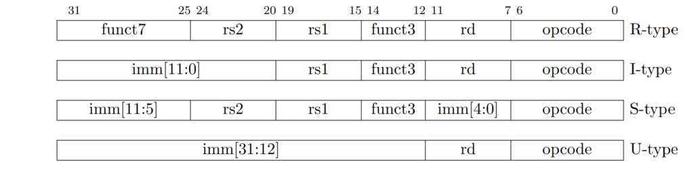
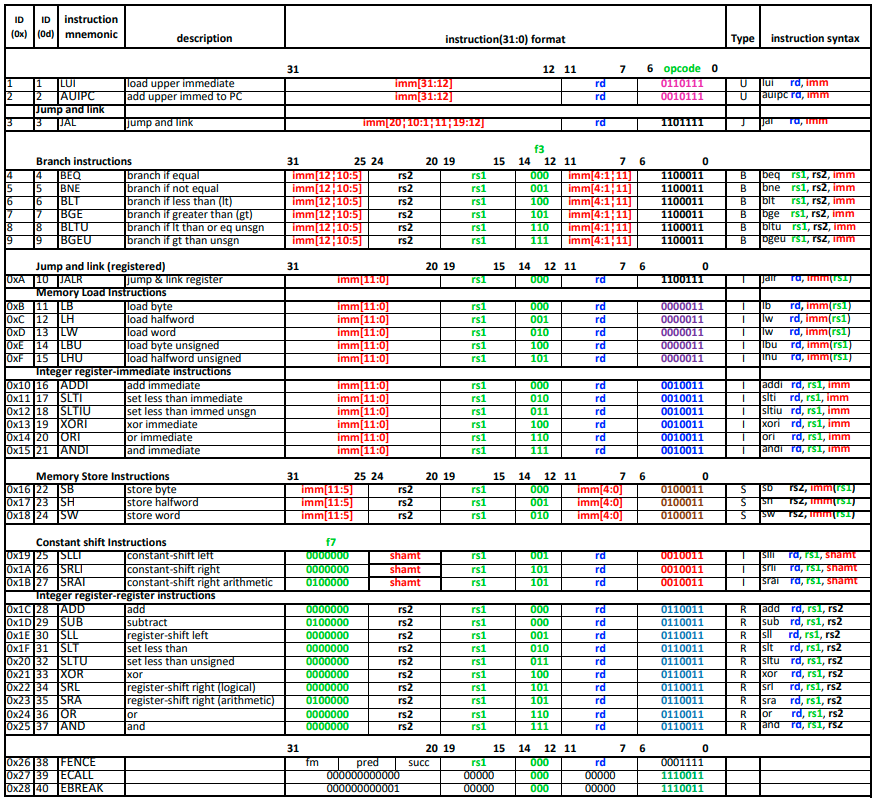
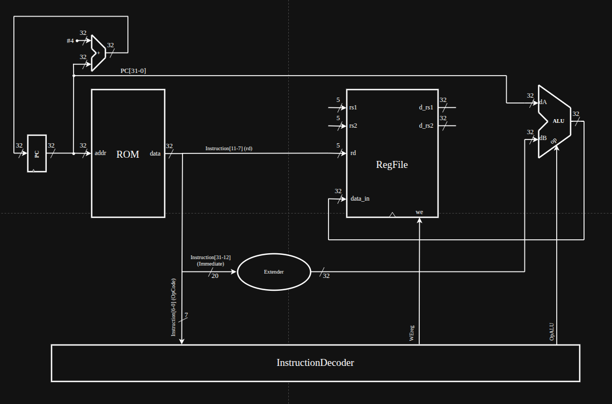
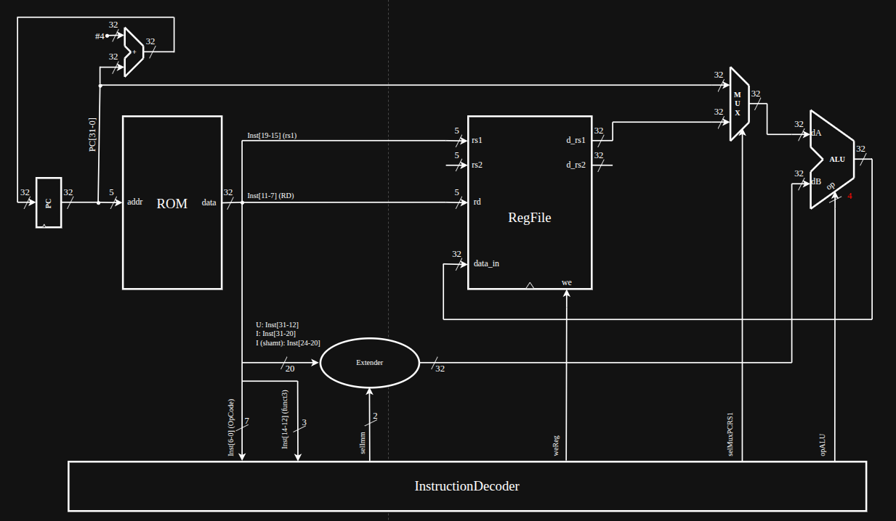
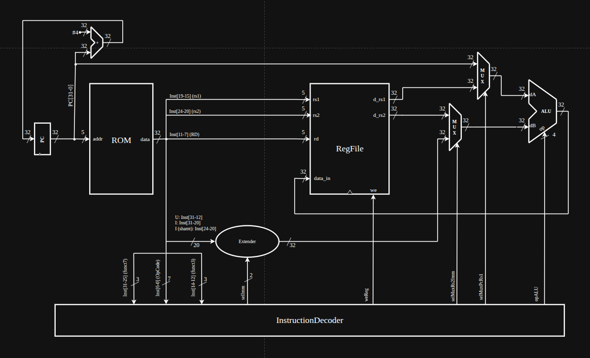
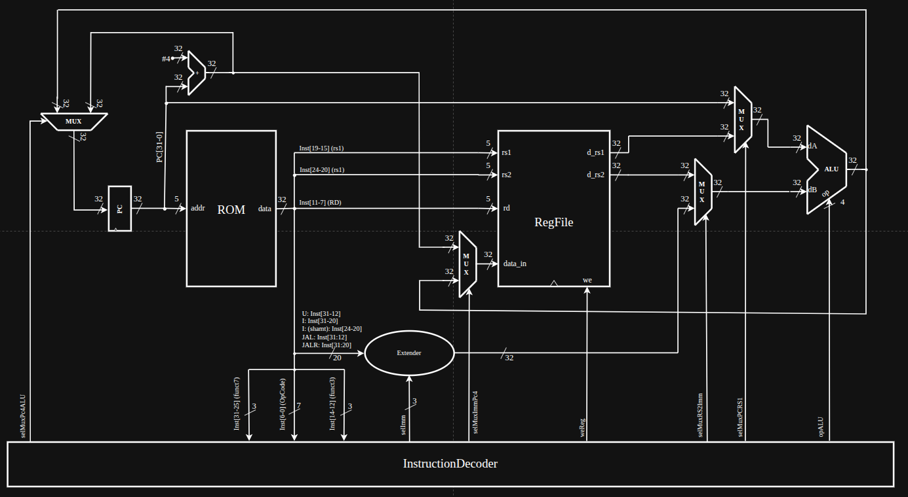
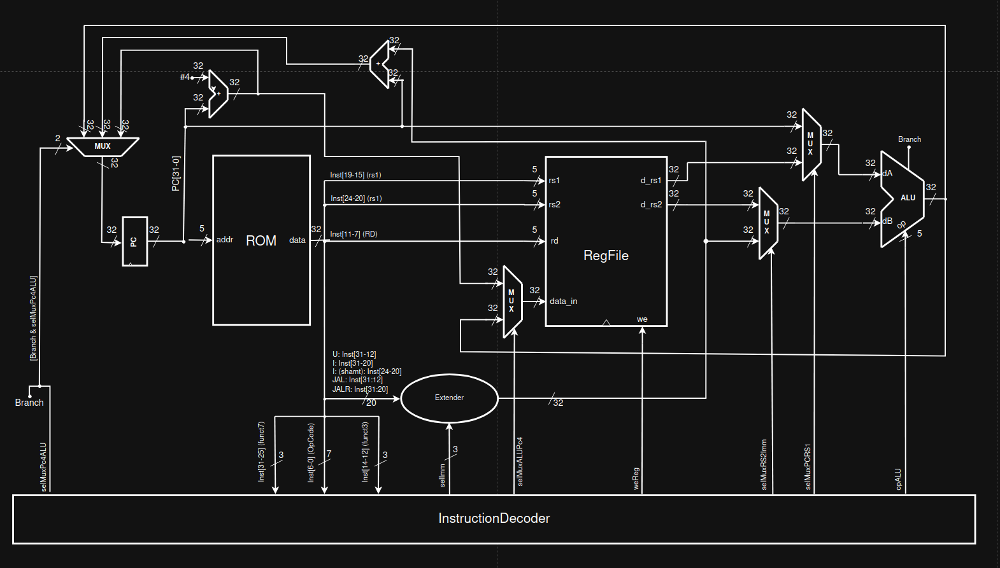
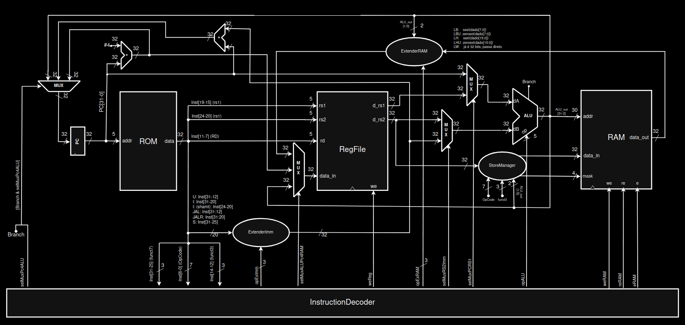

# Implementação Incremental das Instruções da ISA RV32I

Este documento descreve os seis formatos básicos de instrução da arquitetura RISC-V de 32 bits ([green card do RISC-V](../instructions/greencardRISCV.pdf)) e a progressão incremental de datapath e controle para as 37 instruções inteiras da base RV32I.

## 1. Formatos de Instrução da ISA RV32I

| Formato | Finalidade arquitetural |
| :--- | :--- |
| **R-type** | Operações aritméticas, lógicas, deslocamentos e comparações entre dois registradores (`rs1` e `rs2`), gravando o resultado em `rd` |
| **I-type** | Operações com imediato de 12 bits com sinal (`ADDI`..`ANDI`), deslocamentos por constante de 5 bits (`SLLI`, `SRLI`, `SRAI`), leituras de memória (`LB`..`LW`) e salto indireto (`JALR`) |
| **S-type** | Escritas de byte, meia-palavra e palavra completa em memória (`SB`, `SH`, `SW`) com offset de 12 bits dividido nos campos `[31:25]` e `[11:7]` |
| **B-type** | Desvios condicionais relativos ao PC (`BEQ`, `BNE`, `BLT`, `BGE`, `BLTU`, `BGEU`) com offset de 13 bits alinhado a 2 bytes |
| **U-type** | Carregamento de imediato superior de 20 bits nos bits `[31:12]` (`LUI`) ou soma desse imediato ao PC (`AUIPC`) |
| **J-type** | Salto incondicional relativo ao PC (`JAL`) com offset de 21 bits alinhado a 2 bytes e gravação de $\text{PC} + 4$ em `rd` |
| **SYSTEM / MISC-MEM** | Instruções de ambiente, CSRs e sincronização de memória de instruções (`ECALL`, `EBREAK`, `MRET`, `CSRR*`, `FENCE`, `FENCE.I`) |

### 1.1. Formato Geral dos Tipos

### 1.2. Formato Individual das Instruções

## 2. Ordem de Construção do Datapath

A construção do caminho de dados divide as instruções da base RV32I em seis grupos progressivos:

1. **Grupo 1 (U-type sem desvio):** `LUI` e `AUIPC` validam a busca sequencial ($\text{PC} + 4$), a extensão `EXT_IMM_U`, a passagem/soma na ULA e a escrita no banco de registradores.
2. **Grupo 2 (I-type aritmético e lógico):** `ADDI`, `XORI`, `ORI`, `ANDI`, `SLTI`, `SLTIU`, `SLLI`, `SRLI` e `SRAI` acrescentam a leitura de `rs1`, as extensões `EXT_IMM_I` e `EXT_IMM_I_SHAMT` e os deslocadores/comparadores na ULA.
3. **Grupo 3 (R-type completo):** `ADD`, `SUB`, `XOR`, `OR`, `AND`, `SLL`, `SRL`, `SRA`, `SLT` e `SLTU` introduzem a segunda porta de leitura (`rs2`) e a seleção `o_sel_rs2_imm` entre registrador e imediato.
4. **Grupo 4 (Saltos incondicionais):** `JAL` e `JALR` introduzem a escrita de $\text{PC} + 4$ no registrador de retorno (`WB_SEL_PC4`) e o redirecionamento do PC (`PC_SRC_BRANCH` e `PC_SRC_JALR`).
5. **Grupo 5 (Desvios condicionais):** `BEQ`, `BNE`, `BLT`, `BGE`, `BLTU` e `BGEU` adicionam a extensão `EXT_IMM_B` e a flag `o_branch` da ULA para desvio condicional.
6. **Grupo 6 (Loads e Stores):** `LW`, `LH`, `LHU`, `LB`, `LBU`, `SW`, `SH` e `SB` completam o acesso à memória de dados com alinhamento de escrita (`store_manager`) e extensão de leitura (`extender_ram`).

## 3. Detalhamento dos Seis Grupos de Instruções

### 3.1. Grupo 1: U-type (`LUI` e `AUIPC`)

| Instrução | `31:12 (imm)` | `11:7 (rd)` | `6:0 (opcode)` | Assembly | Semântica | Descrição |
| :--- | :--- | :--- | :--- | :--- | :--- | :--- |
| **LUI** | `imm[31:12]` | `rd` | `0110111` | `lui rd, imm` | `x[rd] = imm << 12` | Carrega imediato superior (U-type) |
| **AUIPC** | `imm[31:12]` | `rd` | `0010111` | `auipc rd, imm` | `x[rd] = pc + (imm << 12)` | Soma imediato superior ao PC (U-type) |

- **Extensor de imediato (`extender_imm`):** `EXT_IMM_U` produz `i_instr[31:12] & x"000"`.
- **ULA (`alu`):** `ALU_PASS_B` (`o_d = i_b`) e `ALU_ADD` (`o_d = i_a + i_b`).
- **Controle (`control_unit`):** ativa `o_we_reg = '1'` e `o_sel_rs2_imm = '1'`, selecionando `o_sel_pc_rs1 = '0'` (PC) para `AUIPC`.

### 3.2. Grupo 2: I-type Aritmético e Lógico

| Instrução | `31:25` | `24:20` | `19:15 (rs1)` | `14:12 (funct3)` | `11:7 (rd)` | `6:0 (opcode)` | Assembly | Semântica | Descrição |
| :--- | :--- | :--- | :--- | :--- | :--- | :--- | :--- | :--- | :--- |
| **ADDI** | `imm[11:5]` | `imm[4:0]` | `rs1` | `000` | `rd` | `0010011` | `addi rd, rs1, imm` | `x[rd] = x[rs1] + sext(imm)` | Soma imediato |
| **SLTI** | `imm[11:5]` | `imm[4:0]` | `rs1` | `010` | `rd` | `0010011` | `slti rd, rs1, imm` | `x[rd] = (x[rs1] <s sext(imm)) ? 1 : 0` | Menor que imediato (signed) |
| **SLTIU** | `imm[11:5]` | `imm[4:0]` | `rs1` | `011` | `rd` | `0010011` | `sltiu rd, rs1, imm` | `x[rd] = (x[rs1] <u sext(imm)) ? 1 : 0` | Menor que imediato (unsigned) |
| **XORI** | `imm[11:5]` | `imm[4:0]` | `rs1` | `100` | `rd` | `0010011` | `xori rd, rs1, imm` | `x[rd] = x[rs1] ^ sext(imm)` | XOR com imediato |
| **ORI** | `imm[11:5]` | `imm[4:0]` | `rs1` | `110` | `rd` | `0010011` | `ori rd, rs1, imm` | `x[rd] = x[rs1] \| sext(imm)` | OR com imediato |
| **ANDI** | `imm[11:5]` | `imm[4:0]` | `rs1` | `111` | `rd` | `0010011` | `andi rd, rs1, imm` | `x[rd] = x[rs1] & sext(imm)` | AND com imediato |
| **SLLI** | `0000000` | `shamt[4:0]` | `rs1` | `001` | `rd` | `0010011` | `slli rd, rs1, shamt` | `x[rd] = x[rs1] << shamt` | Shift lógico à esquerda |
| **SRLI** | `0000000` | `shamt[4:0]` | `rs1` | `101` | `rd` | `0010011` | `srli rd, rs1, shamt` | `x[rd] = x[rs1] >>u shamt` | Shift lógico à direita |
| **SRAI** | `0100000` | `shamt[4:0]` | `rs1` | `101` | `rd` | `0010011` | `srai rd, rs1, shamt` | `x[rd] = x[rs1] >>s shamt` | Shift aritmético à direita |

- **Extensor de imediato:** `EXT_IMM_I` estende `i_instr[31:20]` com sinal; `EXT_IMM_I_SHAMT` estende `i_instr[24:20]` com zero.
- **ULA:** adiciona `ALU_XOR`, `ALU_OR`, `ALU_AND`, `ALU_SLT`, `ALU_SLTU`, `ALU_SLL`, `ALU_SRL` e `ALU_SRA` (`signed(i_a) >> unsigned(i_b[4:0])`).

### 3.3. Grupo 3: R-type Completo

| Instrução | `31:25 (funct7)` | `24:20 (rs2)` | `19:15 (rs1)` | `14:12 (funct3)` | `11:7 (rd)` | `6:0 (opcode)` | Assembly | Semântica | Descrição |
| :--- | :--- | :--- | :--- | :--- | :--- | :--- | :--- | :--- | :--- |
| **ADD** | `0000000` | `rs2` | `rs1` | `000` | `rd` | `0110011` | `add rd, rs1, rs2` | `x[rd] = x[rs1] + x[rs2]` | Soma entre registradores |
| **SUB** | `0100000` | `rs2` | `rs1` | `000` | `rd` | `0110011` | `sub rd, rs1, rs2` | `x[rd] = x[rs1] - x[rs2]` | Subtração entre registradores |
| **SLL** | `0000000` | `rs2` | `rs1` | `001` | `rd` | `0110011` | `sll rd, rs1, rs2` | `x[rd] = x[rs1] << x[rs2][4:0]` | Deslocamento lógico à esquerda |
| **SLT** | `0000000` | `rs2` | `rs1` | `010` | `rd` | `0110011` | `slt rd, rs1, rs2` | `x[rd] = (x[rs1] <s x[rs2]) ? 1 : 0` | Menor que (com sinal) |
| **SLTU** | `0000000` | `rs2` | `rs1` | `011` | `rd` | `0110011` | `sltu rd, rs1, rs2` | `x[rd] = (x[rs1] <u x[rs2]) ? 1 : 0` | Menor que (sem sinal) |
| **XOR** | `0000000` | `rs2` | `rs1` | `100` | `rd` | `0110011` | `xor rd, rs1, rs2` | `x[rd] = x[rs1] ^ x[rs2]` | OU exclusivo bit a bit |
| **SRL** | `0000000` | `rs2` | `rs1` | `101` | `rd` | `0110011` | `srl rd, rs1, rs2` | `x[rd] = x[rs1] >>u x[rs2][4:0]` | Deslocamento lógico à direita |
| **SRA** | `0100000` | `rs2` | `rs1` | `101` | `rd` | `0110011` | `sra rd, rs1, rs2` | `x[rd] = x[rs1] >>s x[rs2][4:0]` | Deslocamento aritmético à direita |
| **OR** | `0000000` | `rs2` | `rs1` | `110` | `rd` | `0110011` | `or rd, rs1, rs2` | `x[rd] = x[rs1] \| x[rs2]` | OU inclusivo bit a bit |
| **AND** | `0000000` | `rs2` | `rs1` | `111` | `rd` | `0110011` | `and rd, rs1, rs2` | `x[rd] = x[rs1] & x[rs2]` | E lógico bit a bit |

- **ULA:** adiciona `ALU_SUB` (`o_d = i_a - i_b`).
- **Controle:** mantém `o_sel_pc_rs1 = '1'` (`rs1`) e `o_sel_rs2_imm = '0'` (`rs2`) apenas quando `funct7` vale `FUNCT7_DEFAULT` (`"0000000"`) ou `FUNCT7_ALT` (`"0100000"`).

### 3.4. Grupo 4: Saltos Incondicionais (`JAL` e `JALR`)

| Instrução | `31:25` | `24:20` | `19:15` | `14:12` | `11:7 (rd)` | `6:0 (opcode)` | Assembly | Semântica | Descrição |
| :--- | :--- | :--- | :--- | :--- | :--- | :--- | :--- | :--- | :--- |
| **JAL** | `imm[20\|10:5]` | `imm[4:1\|11]` | `imm[19:15]` | `imm[14:12]` | `rd` | `1101111` | `jal rd, off` | `x[rd] = pc + 4; pc = pc + sext(off)` | Salto relativo ao PC (J-type) |
| **JALR** | `imm[11:5]` | `imm[4:0]` | `rs1` | `000` | `rd` | `1100111` | `jalr rd, rs1, off` | `t = pc + 4; pc = (x[rs1] + sext(off)) & ~1; x[rd] = t` | Salto indireto via `rs1` (I-type) |

- **Extensor de imediato:** `EXT_IMM_J` para `JAL` e `EXT_IMM_I` para `JALR`.
- **ULA e Controle:** `o_sel_pc4_alu = '1'` e `o_wb_sel = WB_SEL_PC4` selecionam $\text{PC} + 4$ como dado de retorno para `rd`, enquanto `ALU_JALR` calcula o endereço-alvo de `JALR` com o bit 0 zerado.

### 3.5. Grupo 5: Desvios Condicionais (`BRANCH`)

| Instrução | `31:25` | `24:20 (rs2)` | `19:15 (rs1)` | `14:12 (funct3)` | `11:7` | `6:0 (opcode)` | Assembly | Semântica | Descrição |
| :--- | :--- | :--- | :--- | :--- | :--- | :--- | :--- | :--- | :--- |
| **BEQ** | `imm[12\|10:5]` | `rs2` | `rs1` | `000` | `imm[4:1\|11]` | `1100011` | `beq rs1, rs2, off` | `if (x[rs1] == x[rs2]) pc += sext(off)` | Desvio se igual |
| **BNE** | `imm[12\|10:5]` | `rs2` | `rs1` | `001` | `imm[4:1\|11]` | `1100011` | `bne rs1, rs2, off` | `if (x[rs1] != x[rs2]) pc += sext(off)` | Desvio se diferente |
| **BLT** | `imm[12\|10:5]` | `rs2` | `rs1` | `100` | `imm[4:1\|11]` | `1100011` | `blt rs1, rs2, off` | `if (x[rs1] <s x[rs2]) pc += sext(off)` | Desvio se menor (signed) |
| **BGE** | `imm[12\|10:5]` | `rs2` | `rs1` | `101` | `imm[4:1\|11]` | `1100011` | `bge rs1, rs2, off` | `if (x[rs1] >=s x[rs2]) pc += sext(off)` | Desvio se maior/igual (signed) |
| **BLTU** | `imm[12\|10:5]` | `rs2` | `rs1` | `110` | `imm[4:1\|11]` | `1100011` | `bltu rs1, rs2, off` | `if (x[rs1] <u x[rs2]) pc += sext(off)` | Desvio se menor (unsigned) |
| **BGEU** | `imm[12\|10:5]` | `rs2` | `rs1` | `111` | `imm[4:1\|11]` | `1100011` | `bgeu rs1, rs2, off` | `if (x[rs1] >=u x[rs2]) pc += sext(off)` | Desvio se maior/igual (unsigned) |

- **Extensor de imediato:** `EXT_IMM_B` reconstrói o deslocamento assinado de 13 bits.
- **ULA e Alvo de Branch:** a ULA compara `rs1` e `rs2` (`ALU_BEQ`..`ALU_BGEU`) gerando `o_branch`, enquanto o somador `u_branch_target_adder` no estágio EX calcula $\text{PC} + \text{imm}$.

### 3.6. Grupo 6: Acesso à Memória (`LOAD` e `STORE`)

| Instrução | `31:25` | `24:20` | `19:15 (rs1)` | `14:12 (funct3)` | `11:7` | `6:0 (opcode)` | Assembly | Semântica | Descrição |
| :--- | :--- | :--- | :--- | :--- | :--- | :--- | :--- | :--- | :--- |
| **LW** | `imm[11:5]` | `imm[4:0]` | `rs1` | `010` | `rd` | `0000011` | `lw rd, off(rs1)` | `x[rd] = M[x[rs1] + sext(off)][31:0]` | Load word (32 bits) |
| **LH** | `imm[11:5]` | `imm[4:0]` | `rs1` | `001` | `rd` | `0000011` | `lh rd, off(rs1)` | `x[rd] = sext(M[x[rs1] + sext(off)][15:0])` | Load halfword com sinal |
| **LHU** | `imm[11:5]` | `imm[4:0]` | `rs1` | `101` | `rd` | `0000011` | `lhu rd, off(rs1)` | `x[rd] = zext(M[x[rs1] + sext(off)][15:0])` | Load halfword sem sinal |
| **LB** | `imm[11:5]` | `imm[4:0]` | `rs1` | `000` | `rd` | `0000011` | `lb rd, off(rs1)` | `x[rd] = sext(M[x[rs1] + sext(off)][7:0])` | Load byte com sinal |
| **LBU** | `imm[11:5]` | `imm[4:0]` | `rs1` | `100` | `rd` | `0000011` | `lbu rd, off(rs1)` | `x[rd] = zext(M[x[rs1] + sext(off)][7:0])` | Load byte sem sinal |
| **SW** | `imm[11:5]` | `rs2` | `rs1` | `010` | `imm[4:0]` | `0100011` | `sw rs2, off(rs1)` | `M[x[rs1] + sext(off)][31:0] = x[rs2][31:0]` | Store word (32 bits) |
| **SH** | `imm[11:5]` | `rs2` | `rs1` | `001` | `imm[4:0]` | `0100011` | `sh rs2, off(rs1)` | `M[x[rs1] + sext(off)][15:0] = x[rs2][15:0]` | Store halfword (16 bits) |
| **SB** | `imm[11:5]` | `rs2` | `rs1` | `000` | `imm[4:0]` | `0100011` | `sb rs2, off(rs1)` | `M[x[rs1] + sext(off)][7:0] = x[rs2][7:0]` | Store byte (8 bits) |

- **Cálculo de endereço efetivo:** `ALU_ADD` soma `rs1` ao imediato `EXT_IMM_I` (loads) ou `EXT_IMM_S` (stores).
- **Escrita (`store_manager` no estágio EX):** posiciona `rs2` nas lanes de byte segundo `ea[1:0]` e produz `o_byte_mask`.
- **Leitura (`extender_ram` no estágio WB):** seleciona o byte ou meia-palavra segundo `ea[1:0]` e estende conforme `o_ext_ram_op` (`EXT_RAM_LW`, `EXT_RAM_LH`, `EXT_RAM_LHU`, `EXT_RAM_LB`, `EXT_RAM_LBU`), gravando o resultado via `WB_SEL_RAM`.

---

Copyright 2026 Insper. Licenciado sob a [Apache License, Version 2.0](../../LICENSE).
